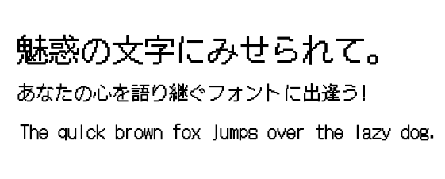

[English](https://github.com/fontworks-fonts/DotGothic16) /[日本語](README-JP.md) 

## DotGothic16-Regular

Dotgothic 16 is based on the old 16x16 Gothic bitmap font that can best recreate the feel of pixel fonts from old video games, cell phones and computer screens on print. With its high readability, this font has become more popular in recent years due to the growing popularity of pixel art.
[Learn more](https://fontworks.co.jp/fontsearch/dotgothic16std-m/).

### Download the font

You can download pre-built the TrueType font from the following page.

[Latest release](https://github.com/fontworks-fonts/DotGothic16/tree/master/fonts/ttf)

### Building the font from source

#### Requirements

* [python3](https://www.python.org/)  
* [fontmake](https://github.com/googlefonts/fontmake/)
* [fonttools](https://github.com/fonttools/fonttools/)
* [ttfautohint](https://www.freetype.org/ttfautohint/doc/ttfautohint.html)  

#### Build the font

Change the current working directory to 'DotGothic16' folder and run **build.py** .

    $ python build.py

If the **--autohinting** command line option is specified, it will add hinting with ttfautohint.

    $ python build.py --autohinting

### DotGothic16 Proportional

**build.py** also writes a second family, **DotGothic16 Proportional**, to `fonts/ttf/DotGothic16Proportional-Regular.ttf` .

DotGothic16 is duo-spaced: every half-width glyph sits in a fixed 500-unit (8-dot) cell, so the narrow ones carry a lot of blank space -- `l` is 73 units of ink with 213 units of blank on each side. The proportional family respaces those 296 Latin and punctuation glyphs from their own ink, on the 62.5-unit dot grid. No outline is redrawn and no glyph leaves the grid.

DotGothic16-Regular is unchanged. The full-width glyphs, and the `.half` forms reached through `hwid`, keep their fixed widths in both families, and figures stay tabular. The spacing is set by `TRACKING_COLS` in **proportional.py** , the number of blank dot columns given to each glyph.

### Licence

This font is licensed under the [SIL Open Font License](https://scripts.sil.org/cms/scripts/page.php?site_id=nrsi&id=OFL).

### Characters

* All glyphs in [Adobe-Japan1-3](https://github.com/adobe-type-tools/Adobe-Japan1)
* [GF Latin Core](https://github.com/googlefonts/gftools/tree/master/Lib/gftools/encodings/GF%20Glyph%20Sets#gf-latin-core)  

### Prohibited acts

* Redistribute under license except 'SIL Open Font License Version 1.1'.
* Selling ​​the font file itself.
